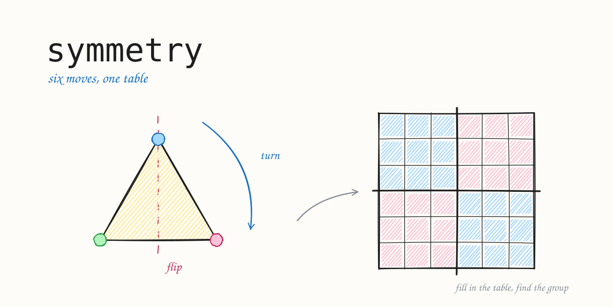
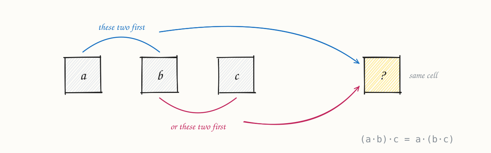

<p align="center"></p>

# Symmetry

**A puzzle game about group theory: fill in a multiplication table and find out which group you made.**

### [▶ Play in the browser](https://shuxueshuxue.github.io/Symmetry/)

<p align="center"></p>

**A few cells fix the whole table.** Every puzzle has exactly one solution, and you are not told
which group it is. Solve it and the game names it: there are 23 to collect.

<p align="center"></p>

**The rules are the axioms.** Each element once in every row and column, and `(a·b)·c = a·(b·c)`.
Hints say which of the two forces a cell.

Three difficulties, puzzles generated as you play, and a build mode that starts from an empty table.
English and 中文. Nothing to install.

## In a terminal

The same game over the same core, for people and for programs that want to play it one command at a time.

```sh
npx github:shuxueshuxue/Symmetry             # sit and play
npx github:shuxueshuxue/Symmetry new 8 normal
npx github:shuxueshuxue/Symmetry "2*6=7"     # write 2·6 = 7
npx github:shuxueshuxue/Symmetry hint
npx github:shuxueshuxue/Symmetry show --json
```

A puzzle has a code, like `8-n-k3f9`. The same code is the same puzzle here and on the page
(`…/Symmetry/#8-n-k3f9`). `symmetry help` lists the rest.

## What the difficulties promise

| | |
|---|---|
| Easy | the two rules finish it, one cell at a time |
| Normal | the rules do not finish it, even with what any student of groups sees at a glance; a few suppositions do |
| Expert | no given can be removed, and a few suppositions are not enough |

"At a glance" means: the identity fixes everything and nothing else fixes anything; inverses work from both sides;
an element's order divides the group's; a group of prime or prime-squared order is commutative. A puzzle that
falls to those is not called hard. `symmetry audit` shows what the generator makes for every group, and the
tests check that no group is left out.

```sh
npm install && npm run dev   # run it locally
npm test                     # the group theory core
npm run audit:layout         # every screen, every state, every window size: nothing may overflow
npm run build:cli            # bin/symmetry.mjs
python3 -I docs/art/make.py  # redraw the pictures
```

The first version, written in Python with pygame, is in this repository's history.
