<p align="center"></p>

# Symmetry

**A puzzle game about group theory: fill in a multiplication table and find out which group you made.**

### [▶ Play in the browser](https://shuxueshuxue.github.io/Symmetry/)

<p align="center"></p>

**A few cells fix the whole table.** Every puzzle has exactly one solution, and you are not told
which group it is. Solve it and the game names it: there are 23 to collect.

<p align="center"></p>

**The rules are the axioms.** Each element once in every row and column, and `(a·b)·c = a·(b·c)`.
Hints say which of the two forces a cell.

Three difficulties, puzzles generated as you play, and a build mode that starts from an empty table.
English and 中文. Nothing to install.

```sh
npm install && npm run dev   # run it locally
npm test                     # the group theory core
python3 -I docs/art/make.py  # redraw the pictures
```

The first version, written in Python with pygame, is in this repository's history.
